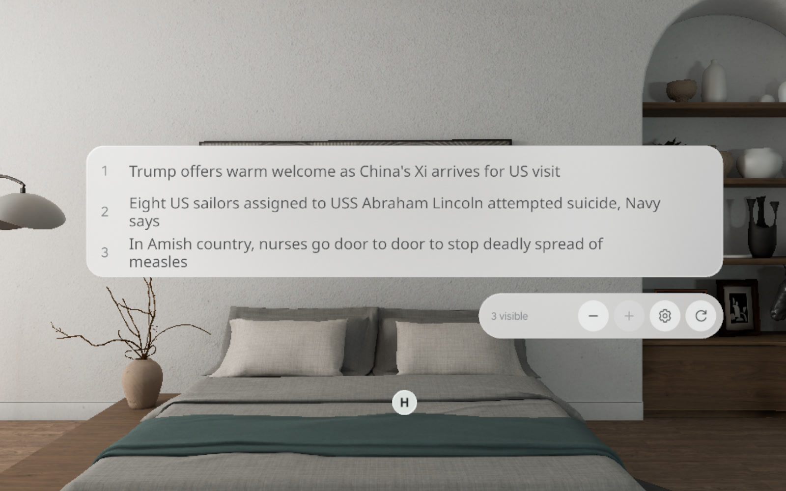
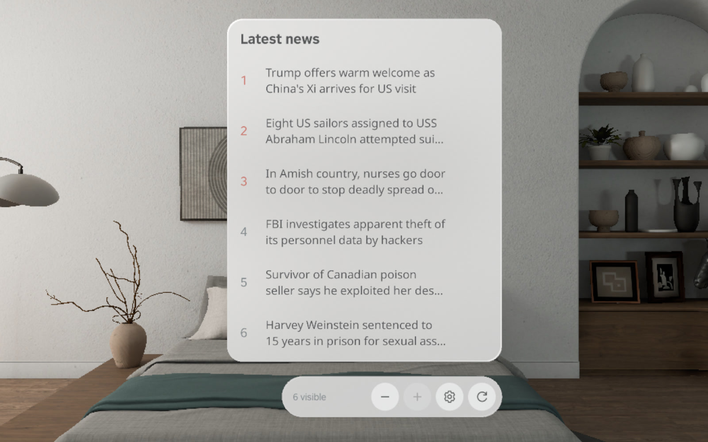
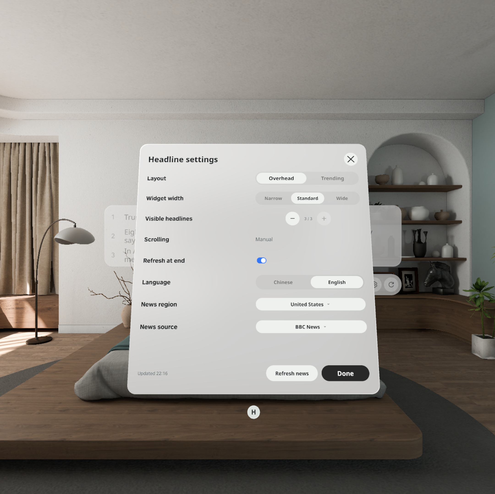

# SpatialHeadlines

[中文](README.zh-CN.md) · [Download APK](https://github.com/kejing-dev/SpatialHeadlines/releases/tag/v1.4.1) · [QA evidence](docs/QA.md) · [Project context](docs/CONTEXT.md)

A native PICO OS 6 spatial news reader built with PICO Spatial SDK and Spatial UI. Read real publisher headlines in an overhead strip or a compact Trending window, scroll at your own pace, and open the exact article in PICO Browser.



## Experience

- **Two layouts:** Overhead has 1–3 visible rows and three widths; Trending has 1–6 visible rows. Both scroll through the complete feed, up to 30 articles. Trending is a compact numbered news layout; it does not claim to be a popularity ranking.
- **Manual scrolling:** no autoplay, timed movement or automatic paging.
- **Separate toolbar:** −, +, settings and refresh stay outside the headlines. Row count changes the viewport, not the number of available stories.
- **Stable refresh:** preserve the article and offset while checking for updates. New stories wait behind **View latest**. Optional refresh when reaching the end is on by default and throttled to once per minute.
- **Independent settings window:** layout, width, per-mode row counts, English/Chinese news editions, source, region and end refresh persist immediately. English is the default; interface labels remain English.
- **Real articles:** BBC and Guardian US/UK feeds, BBC Chinese and DW Chinese. The separate article action opens its corresponding publisher URL, with no Google News search fallback.
- **Native presentation:** PICO glass, Spatial UI controls and scroll indicator, Noto Sans and Noto Sans SC. Windows move with the system window handle.

| Trending | Settings |
| --- | --- |
|  |  |

## Video

[](docs/media/SpatialHeadlines-1.4.1-emulator.mp4)

[Watch/download MP4](docs/media/SpatialHeadlines-1.4.1-emulator.mp4). Recorded from the actual Release APK in PICO Emulator; UI actions are driven by the accessibility test harness. It demonstrates manual scrolling, no automatic movement, row adjustment, refresh position retention and the Trending layout. This is runtime capture, not a Figma animation or physical hand/controller recording.

## Install

Download `SpatialHeadlines-1.4.1-release.apk` and `SHA256SUMS.txt` from [v1.4.1](https://github.com/kejing-dev/SpatialHeadlines/releases/tag/v1.4.1). Requirements: PICO OS 6 with Spatial runtime, Android API 35, arm64-v8a, network access to the chosen publisher.

```sh
shasum -a 256 -c SHA256SUMS.txt
adb devices
adb -s YOUR_DEVICE_SERIAL install -r SpatialHeadlines-1.4.1-release.apk
adb -s YOUR_DEVICE_SERIAL shell am start -n com.headline.news/.platform.LaunchActivity
```

Or use `./scripts/install.sh YOUR_DEVICE_SERIAL /path/to/SpatialHeadlines-1.4.1-release.apk`.

Package: `com.headline.news`; version: `1.4.1` (6). This is a non-debuggable Release build signed with a dedicated release key. It is not a store submission or certification. **The earlier Debug APK uses another certificate, so Android cannot upgrade it in place to this Release APK.** Keep Debug installed until ready to migrate; switching requires removing the old installation, which deletes its local settings/cache. No physical-device app was replaced during release preparation. Future releases signed with the same release key can update this Release build with `install -r`.

## Build

Verified toolchain: PICO CLI 0.5.0, Spatial BOM 6.1.9, PICO Emulator 6.1.0, JDK 21, Gradle 8.13, Android Gradle Plugin 8.13.2, Kotlin 2.1.20, Android SDK 35 / build tools 35.0.0.

Install the PICO development environment and Android SDK, set `JAVA_HOME` to JDK 21, and provide `sdk.dir` in your untracked `local.properties` (or configure the Android SDK in your environment). Dependencies resolve through Google Maven, Maven Central and the PICO Maven repository declared in `settings.gradle.kts`.

```sh
./gradlew :app:assembleDebug :app:testDebugUnitTest :app:lintDebug
# Release without signing credentials produces an unsigned APK:
./gradlew :app:assembleRelease :app:testReleaseUnitTest
```

For an installable signed release, provide all four variables using your local secret manager or shell environment, then run `./scripts/build-release.sh`:

```text
SPATIAL_RELEASE_STORE_FILE    absolute keystore path
SPATIAL_RELEASE_STORE_PASSWORD
SPATIAL_RELEASE_KEY_ALIAS
SPATIAL_RELEASE_KEY_PASSWORD
```

Output: `app/build/outputs/apk/release/app-release.apk`. No private key, password, machine-specific SDK configuration or authentication token is committed. See [release/signing guide](docs/RELEASING.md).

## Verification and handoff

See [QA.md](docs/QA.md) for build results, test counts, runtime logs, screenshots and precise limits of verification. [PRD.md](docs/PRD.md) captures current acceptance criteria; [CONTEXT.md](docs/CONTEXT.md) preserves decisions and implementation history; [ARCHITECTURE.md](docs/ARCHITECTURE.md) maps the code. [AGENTS.md](AGENTS.md) is the compact continuation guide.

Physical-device install and launch of Debug 1.4.1 were confirmed before this publication. Physical hand/controller ergonomics, window dragging and long-duration headset stability remain device acceptance items. Publisher pages may require user consent or subscriptions; tests do not accept agreements automatically.

## Design and third-party assets

[Approved Figma V3](https://www.figma.com/design/8NIauHpHQG35aJrJf8iPuy/Headline?node-id=46-1353). [Design exports and accepted corrections](docs/design/DESIGN-NOTES.md) are included. Exports predate comments #7/#8; runtime screenshots show the corrected gear, removed scroll hints and wider scroll-indicator gutter.

Font licenses: [Noto Sans](NOTO-SANS-LICENSE.txt), [Noto Sans SC](NOTO-SANS-SC-LICENSE.txt). Publisher content remains attributed to its sources. SDK dependencies retain their upstream terms. No blanket open-source license is asserted for this private project.
