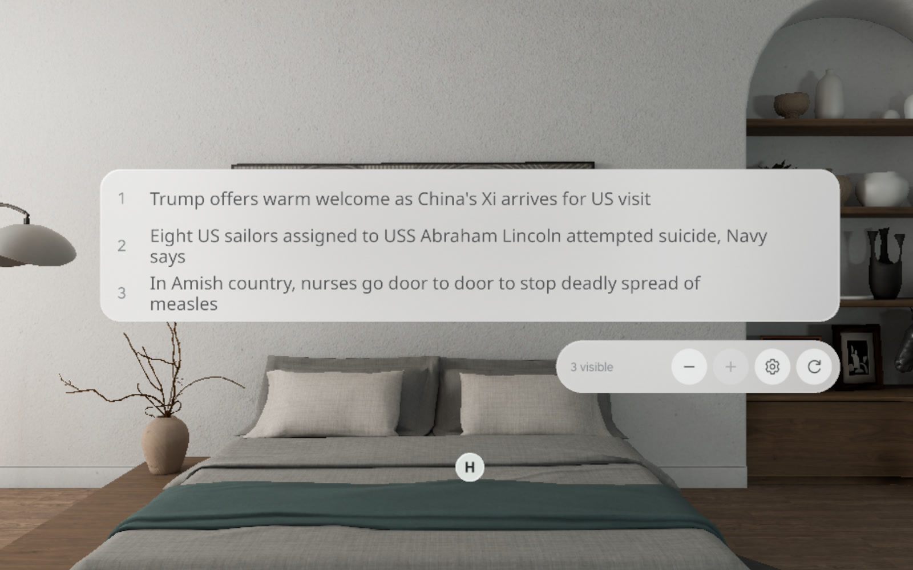
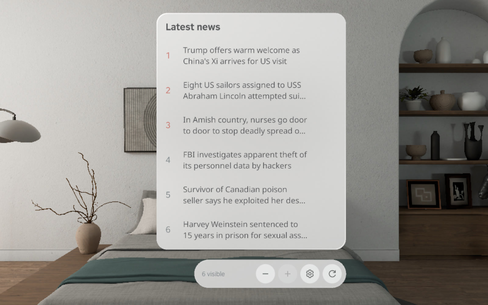
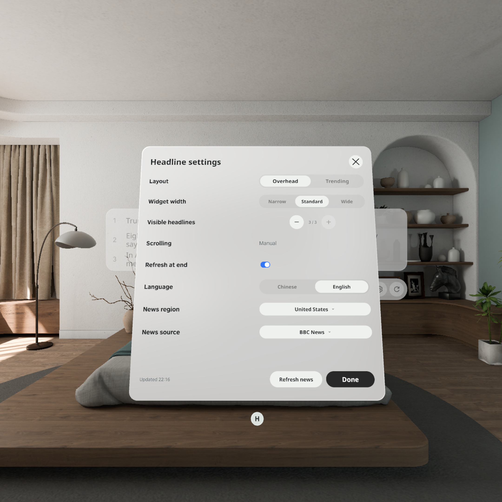

# SpatialHeadlines

[English](README.md) · [下载 APK](https://github.com/kejing-dev/SpatialHeadlines/releases/tag/v1.4.1) · [验收记录](docs/QA.md) · [项目上下文](docs/CONTEXT.md)

基于 PICO Spatial SDK 和 Spatial UI 开发的 PICO OS 6 原生空间新闻应用。以头顶横条或紧凑的 Trending 小窗阅读真实新闻，手动滚动，并在 PICO Browser 中打开对应的原文。



## 功能

- **两种布局：** Overhead 同时显示 1–3 条，支持三档宽度；Trending 同时显示 1–6 条。两种布局都可以滚动阅读完整队列，最多 30 条。Trending 是编号新闻列表，不伪造热度或宣称真实热搜排名。
- **手动滚动：** 不自动滚屏、不定时翻页。± 只改变可见行数，不限制新闻总数。
- **独立工具栏：** 减、加、设置、刷新放在新闻区域下方单独一排。
- **刷新保位：** 刷新时保留当前新闻和阅读位置；新增新闻通过 **View latest** 主动切换。滚到底刷新默认开启，可关闭，同类请求合并，自动检查间隔至少一分钟。
- **独立设置窗口：** 布局、宽度、两种模式各自的行数、中英文内容、新闻源、地区及滚到底刷新立即保存。默认英文，界面标签保持英文。
- **真实新闻与原文：** BBC / Guardian 美国和英国新闻、BBC 中文、DW 中文；独立原文按钮跳转到该条新闻的发布页，不使用 Google News 搜索链接。
- **原生空间风格：** PICO 玻璃材质、Spatial UI 控件与滚动指示器、Noto Sans / Noto Sans SC。通过系统窗口把手移动窗口。

| Trending 小窗 | 独立设置 |
| --- | --- |
|  |  |

## 演示视频

[](docs/media/SpatialHeadlines-1.4.1-emulator.mp4)

[播放或下载 MP4](docs/media/SpatialHeadlines-1.4.1-emulator.mp4)。视频录自运行 Release APK 的 PICO Emulator，测试脚本通过无障碍接口执行操作，展示手动滚动、静止阅读、±、刷新保位以及 Trending 布局。它是实际运行录像，不是设计动画，也不代表真机手势/控制器操作验收。

## 安装

从 [v1.4.1 Release](https://github.com/kejing-dev/SpatialHeadlines/releases/tag/v1.4.1) 下载 `SpatialHeadlines-1.4.1-release.apk` 和 `SHA256SUMS.txt`。需要带 Spatial 运行时的 PICO OS 6、Android API 35、arm64-v8a 及可访问所选新闻源的网络。

```sh
shasum -a 256 -c SHA256SUMS.txt
adb devices
adb -s YOUR_DEVICE_SERIAL install -r SpatialHeadlines-1.4.1-release.apk
adb -s YOUR_DEVICE_SERIAL shell am start -n com.headline.news/.platform.LaunchActivity
```

也可以运行 `./scripts/install.sh YOUR_DEVICE_SERIAL /path/to/SpatialHeadlines-1.4.1-release.apk`。

包名 `com.headline.news`，版本 `1.4.1`（6）。本次为关闭调试、使用独立发布密钥签名的 Release 构建，不代表商店上架或认证。**之前的 Debug 包签名不同，不能直接覆盖安装 Release。** 可以继续保留 Debug；确定迁移时需移除旧安装，这会删除本地设置与缓存。本次发布准备没有替换真机上的应用。以后使用同一发布密钥的版本可以通过 `install -r` 升级。

## 构建与测试

已验证工具链：PICO CLI 0.5.0、Spatial BOM 6.1.9、PICO Emulator 6.1.0、JDK 21、Gradle 8.13、AGP 8.13.2、Kotlin 2.1.20、Android SDK 35 / Build Tools 35.0.0。

安装 PICO 开发环境和 Android SDK，设置 `JAVA_HOME` 指向 JDK 21，并在不提交的 `local.properties` 中配置 `sdk.dir`（或使用环境中的 Android SDK）。依赖仓库已在 `settings.gradle.kts` 声明。

```sh
./gradlew :app:assembleDebug :app:testDebugUnitTest :app:lintDebug
# 未配置签名时，只生成 unsigned Release：
./gradlew :app:assembleRelease :app:testReleaseUnitTest
```

生成可安装的签名 Release 前，通过本机密钥管理工具或环境变量提供 `SPATIAL_RELEASE_STORE_FILE`、`SPATIAL_RELEASE_STORE_PASSWORD`、`SPATIAL_RELEASE_KEY_ALIAS`、`SPATIAL_RELEASE_KEY_PASSWORD`，再执行 `./scripts/build-release.sh`。输出为 `app/build/outputs/apk/release/app-release.apk`。密钥、密码、SDK 本机路径和登录令牌均不上传。详见[发布与签名说明](docs/RELEASING.md)。

## 验收与接续开发

[QA.md](docs/QA.md) 包含构建结果、测试数量、运行日志、截图和验证范围；[PRD.md](docs/PRD.md) 是当前需求及验收标准；[CONTEXT.md](docs/CONTEXT.md) 同步了需求演变、设计决策和开发上下文；[ARCHITECTURE.md](docs/ARCHITECTURE.md) 说明源码结构；[AGENTS.md](AGENTS.md) 供下一次开发快速接续。

发布前已经确认 Debug 1.4.1 在真机安装、启动成功。真机手势与控制器触达、窗口拖动、长时间稳定性仍需设备验收。新闻网站可能有同意条款、地区网络限制或订阅要求，测试不会代替用户接受协议。

## 设计与第三方素材

[已确认的 Figma V3](https://www.figma.com/design/8NIauHpHQG35aJrJf8iPuy/Headline?node-id=46-1353)。仓库包含[设计导出及修订记录](docs/design/DESIGN-NOTES.md)。导出图早于 #7/#8 评论，实际截图包含修正齿轮、去掉滚动提示、扩大滚动条间距后的效果。

字体许可：[Noto Sans](NOTO-SANS-LICENSE.txt)、[Noto Sans SC](NOTO-SANS-SC-LICENSE.txt)。新闻归属原发布方，SDK 依赖遵守各自条款。本私有项目未擅自指定统一开源许可证。
