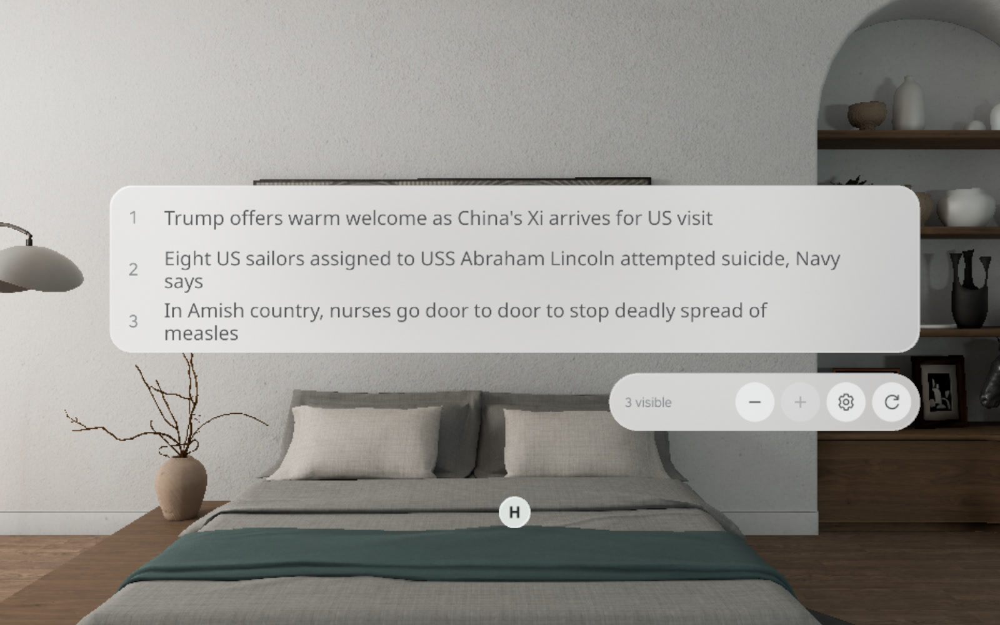
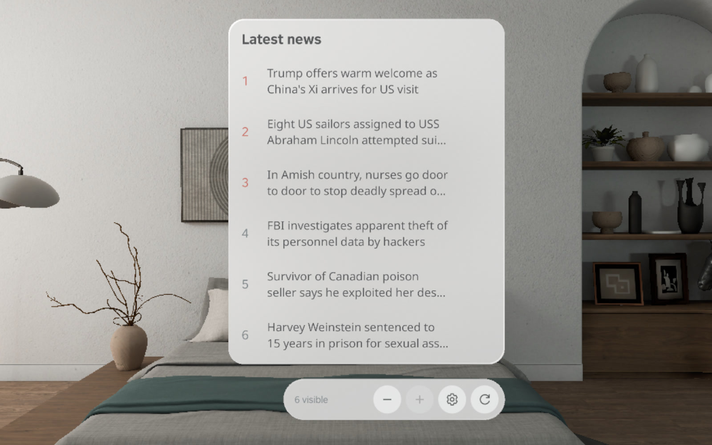

## Headlines | 头条新闻

**介绍**

摆在共享空间里的新闻窗口，可切换为头顶横条或侧边紧凑列表，从真实新闻源获取内容。手动滚动浏览新闻，用独立工具栏的 − / + 调整可见条数，点原文按钮打开对应新闻页面。支持中英文新闻源、独立设置和刷新保位，滚到底可检查更新，新内容等你主动切换后再显示。

**视频**

[SpatialHeadlines-demo.mp4](media/SpatialHeadlines-1.4.1-emulator.mp4)（45 秒，Release APK 模拟器实录）

**截图**

 

[PRD](https://bytedance.us.larkoffice.com/docx/Y7iwdN1kLoFHAzx4k8SuqeWQshg) | [Figma](https://www.figma.com/design/8NIauHpHQG35aJrJf8iPuy/Headline) | [GitHub](https://github.com/kejing-dev/SpatialHeadlines) | `SpatialHeadlines-v1.4.1.apk`

条目写入目标：[Automating Spatial App Production](https://bytedance.larkoffice.com/wiki/LuhIw9gx8iRyqek7VW3czSeLnKf#ZH6Md0wNooJt1lxO3i0urtkxsYg)。格式依据：[spatial-app-showcase](https://github.com/kejing-dev/ai-context/tree/main/skills/spatial-app-showcase)。GitHub 仓库为私有，访问需要仓库权限。
